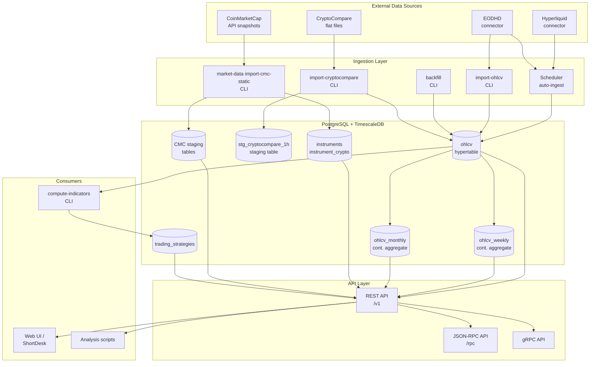
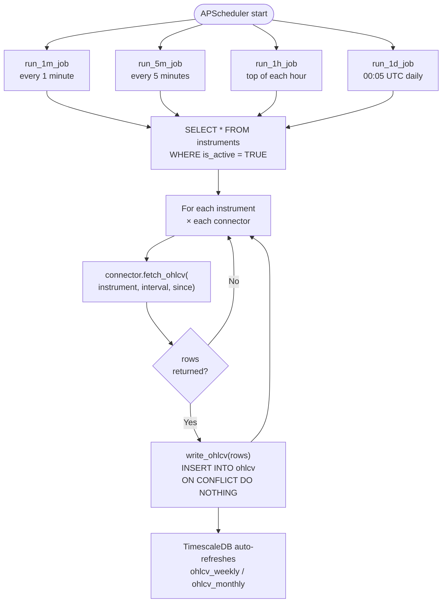
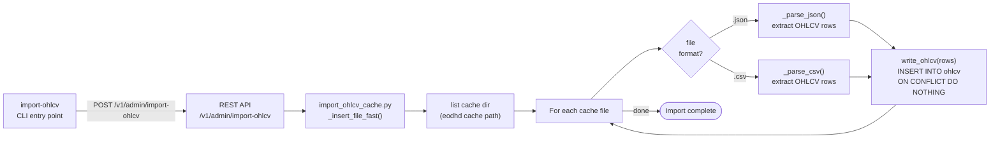
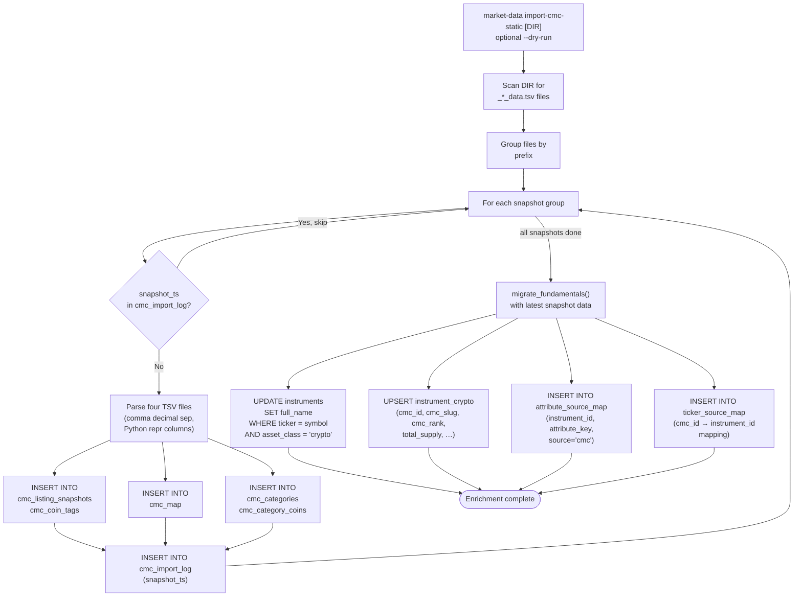
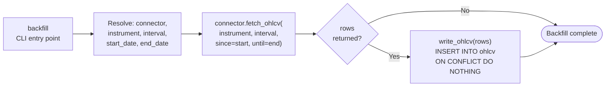
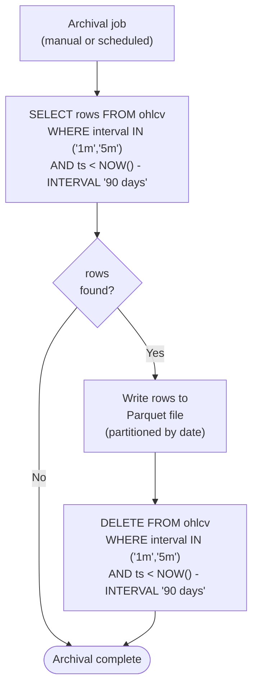
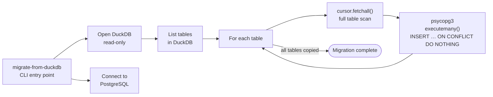
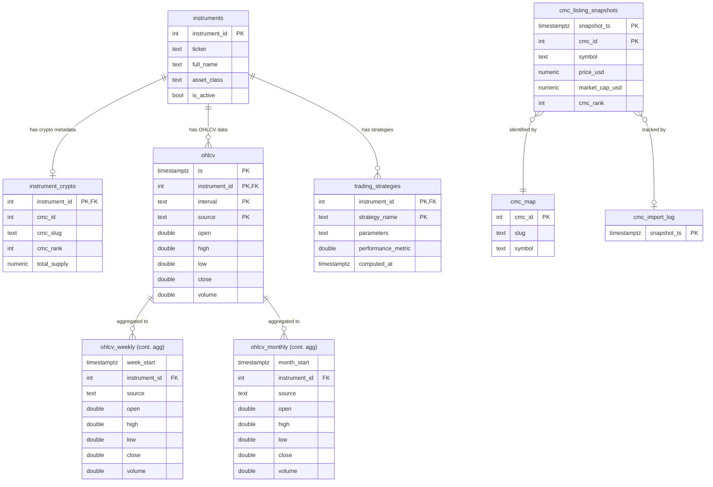
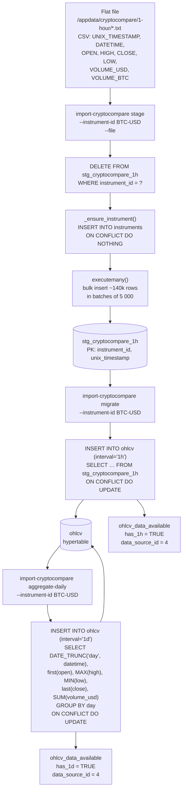

# Data Flow Diagrams

This document describes how data moves into, through, and out of the Market Data Platform,
with a Mermaid diagram for each major process.

---

## 1. Overall System Architecture

---

## 2. Scheduled OHLCV Ingestion

Runs continuously via `scheduler` (or once via `ingest`).  APScheduler fires four jobs at
different frequencies; each job fetches live candles from every active connector and writes
them into the `ohlcv` hypertable.

---

## 3. Bulk OHLCV Import from Local Cache

Used to seed historical data from EODHD cache files on disk.

---

## 4. CoinMarketCap Static Import

Bulk-imports pre-downloaded TSV snapshot files, then promotes the latest data into the
canonical `instruments` / `instrument_crypto` tables.

---

## 5. Strategy / Indicator Computation

Computes the best SMA parameters for each instrument and stores the result.

```mermaid
flowchart LR
    CLI["compute-indicators\nCLI entry point"]

    CLI -->|"POST /v1/admin/compute-indicators\n{instrument, …}"| REST["REST API\n/v1/admin/compute-indicators"]

    REST --> HANDLER["best_sma.py\ncompute_best_sma()"]

    HANDLER --> FETCH["SELECT * FROM ohlcv\nWHERE interval = '1h'\nAND instrument_id = ?"]

    FETCH --> AGG["Aggregate 1h candles\nto daily OHLCV"]

    AGG --> GRID["Grid search over\nfast_period × slow_period"]

    GRID --> EVAL["Evaluate each\n(fast, slow) pair\nby total return / drawdown"]

    EVAL --> BEST["Select best\nparameters"]

    BEST --> UPSERT["INSERT INTO trading_strategies\n… ON CONFLICT DO UPDATE"]

    UPSERT --> DONE([Done])
```

---

## 6. Historical Backfill

Fetches historical OHLCV data from a connector for a specific instrument and date range.

---

## 7. OHLCV Archival

Moves old high-frequency rows out of the live hypertable and into compressed Parquet files
to keep the database lean.

---

## 8. One-Time DuckDB Migration

One-time tool used to bootstrap the PostgreSQL database from the legacy DuckDB file.

---

## 9. Database Schema Summary

The following entity-relationship sketch shows how the key tables relate to each other.

---

## 10. CryptoCompare Flat-File Import

Imports historical OHLCV data from a CryptoCompare CSV flat file into the staging table,
then promotes it to the `ohlcv` hypertable at 1h and 1d resolutions.

Three sub-commands are run in order:

All three commands are idempotent (truncate-per-instrument for staging; `ON CONFLICT DO UPDATE` for `ohlcv`).
